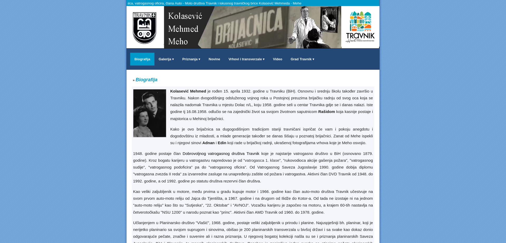
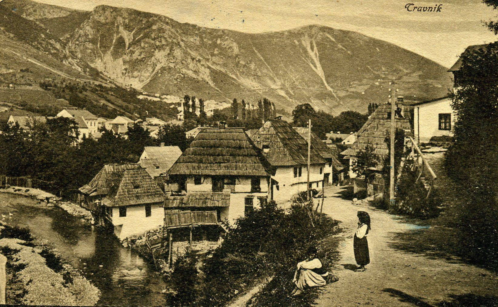
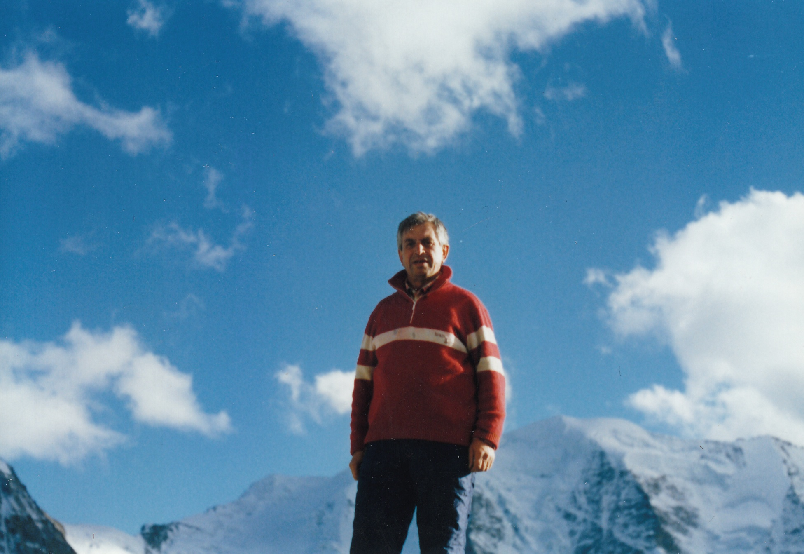
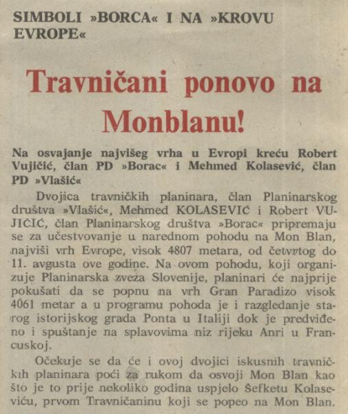

# Meho Kolasevic - legacy stranica

<p align="center">
  
</p>

<br><br>

## O projektu

Ova web stranica predstavlja digitalni spomenar i biografiju posvećenu Mehmedu Mehi Kolaseviću – istaknutom travničkom brici, planinaru, vatrogasnom oficiru i članu Auto-Moto društva Travnik. Pored njegove lične biografije i nevjerovatnih sportskih uspjeha, stranica čuva uspomene na historiju grada Travnika i nudi bogatu galeriju fotografija.

<p align="center">
  
</p>

**Tehnologije i dizajn:**
Ovo je "legacy" statična web stranica. Namjerno je zadržan jednostavan, tradicionalni pristup tehnologiji bez teških modernih frameworka.
* **Frontend:** Čisti HTML5, CSS3 i Vanilla JavaScript.
* **Podaci:** Ne koristi se relacijska baza podataka; galerija dinamički učitava slike čitajući metapodatke iz jednostavnog `slike.json` fajla.
* **Performanse:** Stranica je izuzetno brza i lagana, dizajnirana da se instantno učitava.

---

<p align="center">
  
</p>

---

## Struktura datoteka

Struktura projekta je organizovana na sljedeći način:

```text
.
├── assets                    # Direktorij sa slikama koje se koriste u ovom README dokumentu
│   ├── MehoScreenshot.png
│   ├── novineScreen.jpg
│   ├── planinarstvoScreen.jpg
│   └── travnikScreen.jpg
├── galerija                  # Glavni direktorij za galeriju
│   ├── galerija.html         # Dinamička HTML stranica za generisanje albuma i lightbox prikaza
│   ├── gallery.css           # Specifični stilovi za prikaz slajdova i slika u galeriji
│   ├── slike                 # Folder sa originalnim, velikim fotografijama raspoređenim po kategorijama
│   ├── slike.json            # Baza podataka (JSON format) sa popisom i brojem slika za svaki album
│   ├── thumbnails            # Minijature (umanjene slike) za brže učitavanje mreže (grid) u galeriji
│   └── unknown.PNG           # Fallback (rezervna) slika koja se prikazuje ako original nije pronađen
├── historija.html            # Tekstualna stranica o historiji grada Travnika (od antike do danas)
├── image                     # Folder za statične slike interfejsa
│   ├── baner                 # Slike koje se koriste u rotirajućem slideshow zaglavlju na svakoj stranici
│   └── slika                 # Dodatne ilustracije korištene za biografiju i dizajn
├── index.html                # Početna stranica koja sadrži detaljnu biografiju
├── nagrade.html              # Kategorisan spisak svih priznanja i nagrada koje je Meho dobio
├── robots.txt                # Pravila za web pretraživače (Google, Bing)
├── sitemap.xml               # XML mapa stranice za bolji SEO indeks
├── style.css                 # Glavni CSS fajl koji definiše izgled cijelog sajta (navigacija, fontovi, layout)
├── transverzale.html         # Dokumentovan popis svih obiđenih planinarskih transverzala u ex-Yu regiji
├── video.html                # Stranica sa ugrađenim YouTube snimkom iz emisije "Kako živite ljudi" (1989)
└── vrhovi.html               # Hronološki spisak svih osvojenih planinarskih vrhova (Evropa, Afrika)

```
---
<p align="center">
  
</p>

---

## Kako se pokreće (Homelab Arhitektura)

S obzirom da se radi o čistim statičnim fajlovima, stranica ne zahtijeva Node.js, PHP ili Python backend.

Trenutno se "vrti" na privatnoj homelab infrastrukturi i udaljenom serveru:

1. **Web Server:** Za serviranje fajlova koristi se **Nginx** konfigurisan da poslužuje direktorij sa HTML/CSS/JS datotekama.
2. **Umrežavanje i Sigurnost:** Server nije direktno izložen internetu (nema otvorenih portova na ruteru). Umjesto toga, koristi se **Cloudflare Tunnel** (cloudflared).
3. **Domena:** Cloudflare tunel sigurno povezuje lokalni Nginx server sa domenom `meho.kolasevic.com` i usput obezbjeđuje SSL certifikat (HTTPS), keširanje i zaštitu od napada.